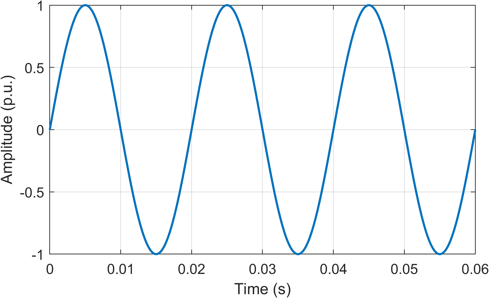

# MATLAB Lab Figure Export

一条 MATLAB 命令，把同一张实验图保存为 **450 DPI PNG** 和 **矢量 PDF**。PNG 适合插入实验报告，PDF 便于放大或排版。

Export the same MATLAB plot as a high-resolution PNG and a vector PDF in one call. Requires MATLAB R2020a or later. No extra toolboxes are needed.



## 快速试用 · Quick start

把 [`export_lab_figure.m`](export_lab_figure.m) 下载到 MATLAB 当前文件夹，也可[在 MATLAB Online 打开仓库](https://matlab.mathworks.com/open/github/v1?repo=lenguoyu/matlab-lab-figure-export)。下面的示例已在 MATLAB R2024b 实测。

Download the function to your current MATLAB folder or [open the repository in MATLAB Online](https://matlab.mathworks.com/open/github/v1?repo=lenguoyu/matlab-lab-figure-export). The example was tested in MATLAB R2024b.

```matlab
t = linspace(0, 0.06, 601);
plot(t, sin(2*pi*50*t), 'LineWidth', 1.5);
grid on
xlabel('Time (s)');
ylabel('Amplitude (p.u.)');
export_lab_figure(gca, 'sine_50hz');
```

当前文件夹会生成 `sine_50hz.png` 和 `sine_50hz.pdf`。已有实验图时，直接用最后一行即可。The last line alone exports your current axes.

```matlab
[pngFile, pdfFile] = export_lab_figure(gca, 'sine_50hz_600dpi', 600);
```

第三个参数只调整 PNG 的 DPI。可以把 `gca` 换成普通图窗句柄 `gcf`，或传入 `tiledlayout` 返回的句柄来导出整组子图。文件名不带扩展名，目标文件夹需提前创建。同名文件存在时会报错并保留原文件。

The third argument changes the PNG resolution. Pass `gcf` for a regular figure or a `tiledlayout` handle for multiple panels. Supply a filename stem without an extension. The destination folder must exist and existing outputs are preserved.
