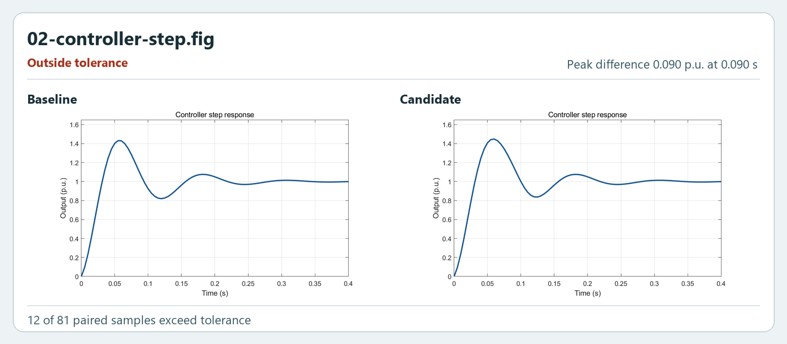

# MATLAB Figure Pack · MATLAB 图稿交付工具

Package saved MATLAB `.fig` files and selected project files into one ZIP for paper figures, coursework, or experiment reviews. The package includes an offline index, PNG and vector PDF exports, supported XY data, and a resolution check at your chosen placement width. Use the same tools to compare two runs, rebuild editable plots, or add an offline Plotly gallery.

把 MATLAB `.fig` 图窗和选定的代码、报告等项目文件打成一个 ZIP，用于论文图稿、作业交付或实验复核。交付包包含离线索引、PNG 和矢量 PDF、可导出的 XY 数据，以及按放置宽度计算的分辨率检查。也可以单独比较两轮实验、重建可编辑曲线，或加入离线 Plotly 图集。

[](https://matlab.mathworks.com/open/github/v1?repo=lenguoyu/matlab-lab-figure-export&file=demo_lab_figure_pack.m) · [Download source / 下载源码](https://github.com/lenguoyu/matlab-lab-figure-export/archive/refs/heads/main.zip) · [Delivery guide / 交付指南](docs/DELIVERY.md)

## Quick start · 快速上手

Run this from the repository root in MATLAB to generate two sample figures, build a delivery ZIP with the demo source and delivery guide, and extract it. Open the last path printed in your browser.

在 MATLAB 中切换到仓库根目录后运行下面的命令。它会生成两张示例图，把示例源码和交付指南一并打包，然后解压。用浏览器打开最后一行输出的 `index.html` 路径。

```matlab
demoFolder = tempname;
[report, pack] = demo_lab_figure_pack(demoFolder);
archive = build_lab_delivery(fullfile(demoFolder, 'fig-input'), ...
    fullfile(demoFolder, 'delivery.zip'), 88.9, 600, ...
    'Files', {'demo_lab_figure_pack.m', 'docs/DELIVERY.md'});
deliveryFolder = fullfile(demoFolder, 'delivery');
unzip(archive, deliveryFolder);
fprintf('Delivery ZIP %s\nOpen %s\n', archive, fullfile(deliveryFolder, 'index.html'));
```

## Workflows · 常用工作流

| Task / 用途 | MATLAB entry point / 命令 |
| --- | --- |
| Package figures, checks, code, and reports / 打包图稿、预检、代码与报告 | `build_lab_delivery` |
| Export a folder of saved figures / 批量导出已保存的图窗 | `export_lab_batch('experiment-figs', 'figure-pack')` |
| Compare two experiment runs / 比较两轮实验 | `compare_lab_packs('baseline-pack', 'candidate-pack', 'comparison')` |
| Check a 600 DPI target at 88.9 mm / 检查 88.9 mm 宽度下是否达到 600 DPI | `check_lab_artwork(pack, 88.9, 600)` |
| Rebuild an editable curve / 重建可编辑曲线 | `replot_lab_figure(fullfile(pack, report.DataCSV(1)))` |
| Export Plotly JSON or an offline gallery / 导出 Plotly JSON 或离线交互图集 | `export_lab_plotly(pack, 'plotly-json')` · [Integration guide / 接入指南](docs/INTEGRATIONS.md) |
| Export one open figure / 导出当前图稿 | `export_lab_figure(gca, 'response')` |

Open `index.html` after extracting either offline example. To generate the comparison in MATLAB, run `demo_lab_pack_comparison('comparison-demo')`.

下载任一离线示例并解压后，打开 `index.html`。也可以在 MATLAB 中运行 `demo_lab_pack_comparison('comparison-demo')` 生成对比示例。

[Workflow guide / 工作流指南](docs/WORKFLOWS.md) · [Comparison example / 对比示例](https://github.com/lenguoyu/matlab-lab-figure-export/raw/refs/heads/main/comparison-example.zip) · [Interactive example / 交互示例](https://github.com/lenguoyu/matlab-lab-figure-export/raw/refs/heads/main/docs/plotly-example.zip)



## Requirements and tests · 环境与测试

The workflows use base MATLAB R2021b or newer and are tested in R2024b. The standalone single-figure exporter works with R2020a or newer. Load only trusted `.fig` files because MATLAB can execute code while opening them.

工作流使用基础 MATLAB R2021b 或更新版本，已在 R2024b 测试。单图导出支持 R2020a 或更新版本。MATLAB 打开 `.fig` 时可能执行代码，请使用可信的图文件。 [MathWorks `openfig`](https://www.mathworks.com/help/matlab/ref/openfig.html)

```matlab
addpath(pwd);
assertSuccess(runtests('tests'));
```

[MIT License / MIT 许可证](LICENSE)
