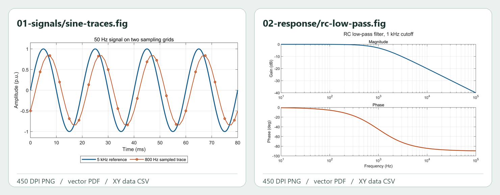

# Workflows · 使用手册

## 1. 论文插图预检

先把 MATLAB 图导出成图包，再输入论文实际放置的宽度和目标 DPI。下面以 88.9 mm、600 DPI 为例。可以用 `Status` 筛选，逐图查看实际像素数、所需像素数和可用的 PDF。

```matlab
[report, pack] = demo_lab_figure_pack('figure-pack-demo');
artwork = check_lab_artwork(pack, 88.9, 600);
disp(artwork(:, {'Source', 'PixelWidth', 'EffectiveDPI', 'RequiredPixelWidth', 'Status'}))
writetable(artwork, 'artwork-check.csv', 'Encoding', 'UTF-8', 'QuoteStrings', true);
```

`EffectiveDPI = PixelWidth × 25.4 / PlacedWidthMm`。在 88.9 mm 宽度放置时，2100 px 正好对应 600 DPI。检查读取 PNG 的实际像素，PDF 列列出图包里可用的 PDF。投稿前还要根据目标期刊及图稿类型检查文字、线宽和符号。不同期刊的栏宽和分辨率要求各异。 [IEEE 尺寸与分辨率](https://journals.ieeeauthorcenter.ieee.org/create-your-ieee-journal-article/create-graphics-for-your-article/resolution-and-size/) · [Nature 插图规范](https://research-figure-guide.nature.com/figures/preparing-figures-our-specifications/) · [Elsevier 图稿尺寸](https://www.elsevier.com/about/policies-and-standards/author/artwork-and-media-instructions/artwork-sizing)

## 2. 作业或实验报告交付

把自己保存的 `.fig` 放进一个目录，运行下列命令。先看计划，再真正导出。收到的 HTML 图集可以浏览预览，`manifest.csv` 记录逐图结果和页码。

```matlab
plan = export_lab_batch('experiment-figs', 'figure-pack', 'DryRun', true);
report = export_lab_batch('experiment-figs', 'figure-pack', 'DPI', 450);
```

```text
figure-pack/
├── index.html
├── manifest.csv
├── figures.pdf
└── plots/
    ├── experiment.png
    ├── experiment.pdf
    └── experiment.csv
```

默认扫描子目录，接收每个文件含一张图的 `.fig`，并写到一个新目录。`'CombinePDF', false` 只生成逐图导出和图集。交付时用 `build_lab_delivery` 把图包、预检和明确选定的报告与代码写成一个 ZIP。 [一键交付指南](DELIVERY.md)



## 3. 从 CSV 重画并继续编辑

图包 CSV 保存支持的二维数值折线。每条曲线保留自己的采样次序、重复横坐标和 NaN 断点。当原来的绘图代码找不到时，可以从已存 XY 数据重建图窗，再改标题、坐标轴和线条。

```matlab
[fig, ax, lines] = replot_lab_figure(fullfile(pack, report.DataCSV(1)));
title(ax(1), 'Experiment response');
lines(1).LineWidth = 1.5;
savefig(fig, 'revised-response.fig');
export_lab_figure(fig, 'revised-response');
```

Bode 图可传 `'XScale', 'log'`，对数轴要求有限坐标为正。CSV 重画使用保存的坐标轴编号和标签。要保留原图排版、颜色或双 Y 轴归属，请打开可信的原始 `.fig`。有多行标题或需要精确对比的早期图包，建议从原 `.fig` 用新版重新导出。 [用户重画案例](https://www.mathworks.com/matlabcentral/answers/1988203-extract-data-from-fig-file-and-redraw-the-plot) · [MathWorks 可编辑图窗](https://www.mathworks.com/help/matlab/creating_plots/save-figure-to-reopen-in-matlab-later)

## 4. 复核一轮实验改动

```matlab
[figures, series] = compare_lab_packs('baseline-pack', 'candidate-pack', ...
    'comparison', 'AbsTol', 0.015, 'RelTol', 0.02);
```

`comparison/index.html` 带筛选、并排预览及随包复制的 PNG，可单独分享。逐图结果在 `comparison.csv`，逐曲线的超差点数、最大绝对偏差和所在横坐标在 `series.csv`。

按原始相对路径匹配图文件，再按坐标轴和曲线编号核对标签。相同 X 网格上的有限配对样本以 `max(AbsTol, RelTol * abs(baselineY))` 为容差。默认两项都是零。共享空缺会跳过，网格或标签变化、缺失曲线和变化的空缺会标记为待复核。并排图也可用于检查版式和视觉变化。 [MathWorks 比较方法](https://www.mathworks.com/help/simulink/ug/how-the-simulation-data-inspector-tool-compares-time-series-data.html)
